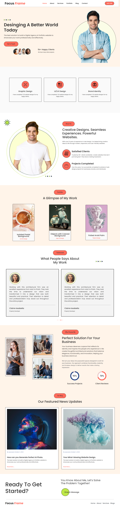

# Focus Frame – WordPress Portfolio Website

Focus Frame is a responsive digital agency and portfolio website built with WordPress. It presents services, selected work, client testimonials and blog content in a clean, modern interface designed to convert visitors into clients.



---

## Table of Contents

1. [Overview](#overview)
2. [Features](#features)
3. [Page Structure](#page-structure)
4. [Skills and Technologies](#skills-and-technologies)
5. [Design System](#design-system)
6. [Repository Structure](#repository-structure)
7. [Installation](#installation)
8. [Customization](#customization)
9. [Key Learnings](#key-learnings)
10. [Author](#author)
11. [License](#license)

---

## Overview

This project is a portfolio and agency website developed with WordPress. It is intended for freelancers, designers and small agencies who need a professional online presence.

**Project objectives**

- Establish a credible, professional web presence
- Present services, portfolio work and testimonials clearly
- Deliver a fully responsive experience across devices
- Apply modern UI/UX and visual design principles

---

## Features

- Responsive layout for desktop, tablet and mobile
- Hero section with social proof and a clear call to action
- Service cards for Graphic Design, UI/UX Design and Brand Identity
- Portfolio showcase with categorized project cards
- Testimonial slider with pagination
- Animated circular progress indicators for key statistics
- Blog section for featured articles and updates
- Contact call-to-action and footer navigation

---

## Page Structure

| Section | Description |
|---|---|
| Header | Logo, primary navigation (Home, About, Services, Portfolio, Blog, Contact) and a "Let's Talk" button |
| Hero | Headline, introductory text, "Get in Touch" button, client avatars with a "5k+ Happy Clients" indicator and a framed profile image |
| Services | Three bordered cards, each with an icon, title and short description |
| About | Profile image, introduction, and highlights for satisfied clients and completed projects |
| Portfolio | "A Glimpse of My Work" with project cards showing image, title and category |
| Testimonials | Client reviews with avatar, quote, name and role |
| Why Choose Me | Image collage, value proposition and circular progress indicators (95% Success Projects, 70% Client Reviews) |
| Blog | "Our Featured News Updates" with image, metadata, title, excerpt and "Read More" link |
| Call to Action | "Ready To Get Started?" with a "Drop A Message" button |
| Footer | Logo and quick navigation links |

---

## Skills and Technologies

### WordPress Development

- Installation, configuration and site settings management
- Creation and organization of pages, posts, menus and widgets
- Layout construction using the block editor or a page builder
- Custom post types for portfolio items and testimonials (where applicable)
- Media library management and permalink configuration
- Plugin selection and configuration for forms, sliders, SEO and performance

### UI/UX Design

- Establishing clear visual hierarchy through typography and spacing
- Card-based layouts for scannable content
- Consistent, reusable components such as buttons, tags, cards and icons
- Use of social proof (statistics, testimonials, client avatars) to build trust
- Strategic placement of calls to action

### Front-End Development

- Semantic HTML5 structure
- CSS3 for custom styling, including circular image masks, bordered cards, rounded buttons and hover states
- Flexbox and CSS Grid for layout
- CSS variables for a consistent color system
- Responsive design with fluid grids and scalable images

### Branding and Visual Design

- Two-tone logo treatment with an italic accent
- Custom service icons and decorative elements
- Image selection, cropping and optimization
- Consistent typography scale across headings, subheadings and body text

### Interactive Components

- Testimonial carousel with pagination
- Animated circular progress indicators
- Hover and transition effects on interactive elements

### Content and SEO

- Clear headline and service copywriting
- Logical content flow from introduction to proof to action
- Correct heading hierarchy (H1 to H3)
- Image alt text, clean URLs and meta descriptions
- Performance-conscious asset usage

### Tooling

- Git and GitHub for version control and documentation
- Local development environments such as LocalWP, XAMPP or MAMP

---

## Design System

### Color Palette

| Role | Value (approximate) |
|---|---|
| Primary accent | `#F4604F` |
| Warm background | `#FEF3E8` |
| Highlight | `#E8F59A` |
| Neutral background | `#F4F4F4` |
| Text | `#1A1A1A` |

### Typography

- **Typeface:** Poppins or a similar geometric sans-serif
- **Headings:** Medium to semi-bold weight, large scale
- **Body text:** Regular weight with generous line spacing

### Interface Elements

- Pill-shaped primary buttons
- Rounded tag labels above section titles
- Sharp-bordered cards for services and testimonials
- Circular image frames with thin outlines

---

## Repository Structure

```
focus-frame/
├── wp-content/
│   ├── themes/
│   │   └── focus-frame/
│   ├── plugins/
│   └── uploads/
├── database.sql
├── home.png
└── README.md
```

Update this structure to reflect the actual contents of the repository.

---

## Installation

### Prerequisites

- PHP 7.4 or higher
- MySQL 5.7 or higher (or MariaDB equivalent)
- A local server environment (LocalWP, XAMPP, WAMP or MAMP)

### Steps

1. Clone the repository:
   ```bash
   git clone https://github.com/your-username/focus-frame.git
   ```
2. Place the project in your server's web root (`htdocs` or `www`).
3. Create a new database using phpMyAdmin or the command line.
4. Import `database.sql` into the new database, if provided.
5. Update `wp-config.php` with your database name, username and password.
6. Visit `http://localhost/focus-frame` in your browser.
7. Access the administration panel at `/wp-admin`.

---

## Customization

- **Branding:** Appearance > Customize to update the logo, colors and fonts
- **Content:** Edit pages with the block editor or page builder
- **Portfolio and blog:** Add new entries from the WordPress dashboard
- **Navigation:** Appearance > Menus to manage header and footer links

---

## Key Learnings

- Planning a website from wireframe through to launch
- Translating a design concept into a functional WordPress site
- Building consistent, reusable interface components
- Designing for responsiveness and usability
- Presenting services and work in a way that supports client acquisition

---

## Author

**Aqsa Javed**

- GitHub: [@aqsajaved8822](https://github.com/your-username)
- LinkedIn: [your-profile](https://linkedin.com/in/your-profile)
- Email: Aqsajaved8822@gmail.com

---
